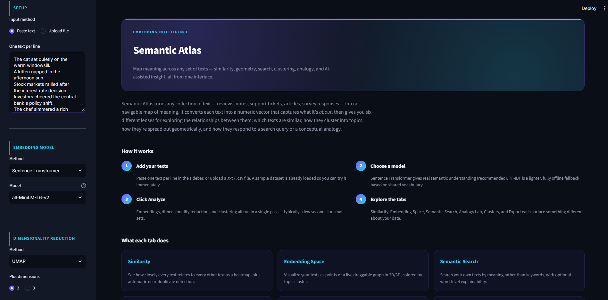
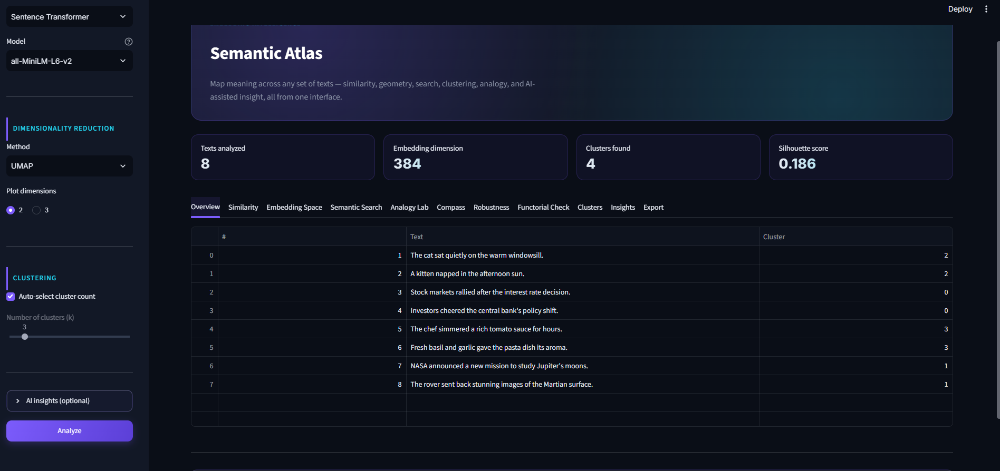
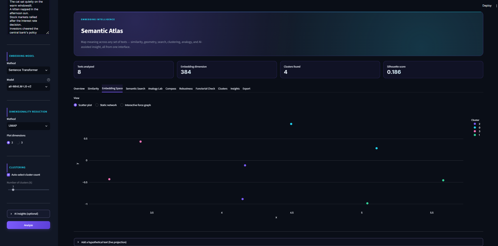
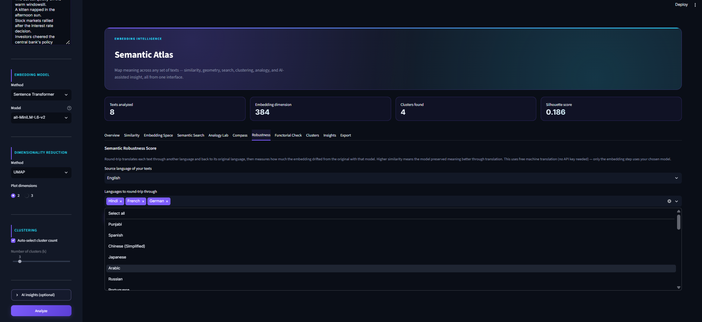

#  Semantic Atlas

**Semantic Atlas** is an interactive NLP-based platform that transforms text into high-dimensional embeddings to explore semantic relationships, similarity, clustering, and meaning preservation.

It provides tools to analyze how meaning changes across translation and summarization operations through machine learning, mathematical analysis, and interactive visualizations.

<p align="center">
  
</p>

##  Key Features

The application consists of 11 interactive modules:

- **Overview:** Text analysis, cluster assignments, and outlier detection.
- **Similarity:** Cosine similarity heatmaps and duplicate detection.
- **Embedding Space:** Interactive 2D/3D semantic visualizations.
- **Semantic Search:** Context-based text retrieval.
- **Analogy Lab:** Vector arithmetic and semantic interpolation.
- **Compass:** Analyze texts along custom semantic dimensions.
- **Robustness:** Measure meaning preservation through round-trip translation.
- **Functorial Check:** Compare different sequences of translation and summarization.
- **Clusters:** Semantic grouping, keywords, and cluster insights.
- **Insights:** Zero-shot tagging and coverage gap analysis.
- **Export:** Download embeddings, clusters, JSON data, and HTML reports.


##  Tech Stack

| Category | Technologies |
|---|---|
| Programming Language | Python 3.10+ |
| Framework | Streamlit |
| NLP & Embeddings | Sentence-Transformers |
| Embedding Models | MiniLM, MPNet, Multilingual MiniLM |
| Machine Learning | Scikit-learn |
| Clustering | K-Means, Silhouette Score |
| Dimensionality Reduction | PCA, UMAP, t-SNE |
| Visualization | Plotly |
| Data Processing | NumPy, Pandas |
| Translation | deep-translator |
| LLM Integration | Anthropic Claude API |

##  Project Structure

```text
semantic-atlas/
│
├── app.py
├── requirements.txt
├── README.md
├── .gitignore
├── .streamlit/
│   └── config.toml
└── docs/
    ├── screenshots/
    │   ├── 01-home.png
    │   ├── 02-overview.png
    │   ├── 04-embedding-space.png
    │   └── 08-robustness.png
    ├── Semantic_Atlas_Project_Report.docx
    └── paper.pdf
```

##  Installation & Setup

**1. Clone the repository**

```bash
git clone https://github.com/YOUR_USERNAME/semantic-atlas.git
cd semantic-atlas
```

**2. Create a virtual environment**

```bash
python -m venv .venv
```

**3. Activate the environment**

Windows:

```powershell
.venv\Scripts\Activate.ps1
```

macOS / Linux:

```bash
source .venv/bin/activate
```

**4. Install dependencies**

```bash
pip install -r requirements.txt
```

**5. Run the application**

```bash
python -m streamlit run app.py
```

Open `http://localhost:8501` in your browser.

**Note:** The first run downloads the selected embedding model. Translation and optional AI-powered features require internet connectivity.

##  Screenshots

### Home Page


### Overview Dashboard


### Semantic Embedding Space


### Semantic Robustness Analysis


##  Future Scope

- Standardized multilingual evaluation benchmarks.
- Additional semantic preservation metrics.
- Extended transformation analysis.
- Improved semantic coverage detection.
- Evaluation of additional multilingual embedding models.

##  Author

- **Sehaj Kaur** – Amity School of Engineering and Technology


